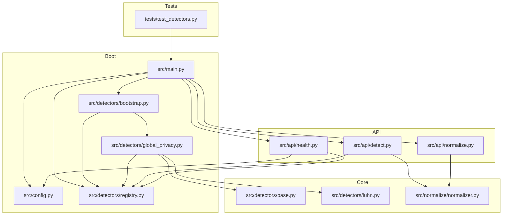
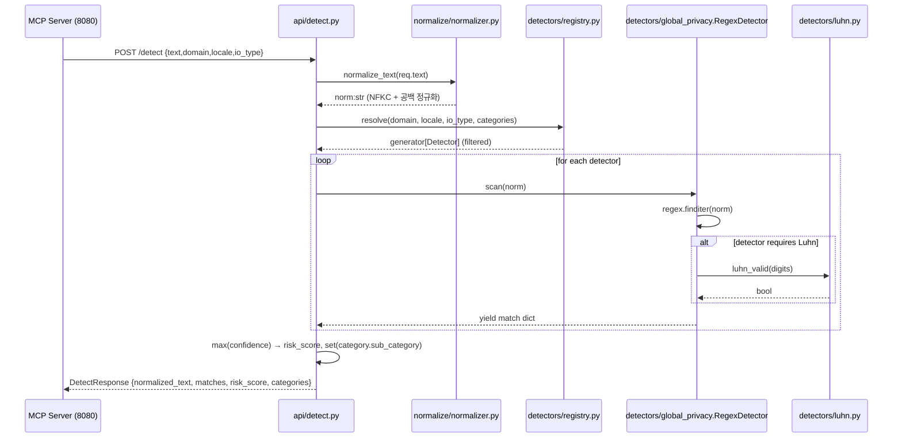
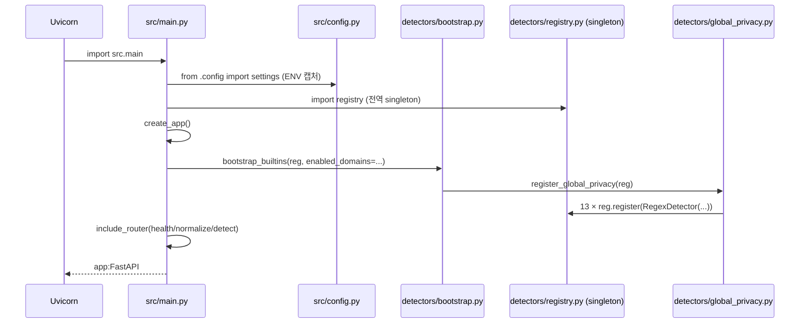

# Detection Engine — Code Review (Level 2)

- 분석일 / Analysis Date: 2026-05-20
- 대상 / Target: `/Users/wise/Developer/DA(Python,R,...)/Guardrails-Service-Detection-Engine`
- 리뷰 레벨 / Review Level: **2** (~3y junior, handover-quality)
- 선택 파일 수 / Selected Files: 12 (실제 소스 + 테스트, 빈 `__init__.py` 4건 포함)
- 분석 모델 / Analyzed by: Claude Opus 4.7 (1M context)

---

## 1. Workspace Inventory

### 1.1 Root layout

```
Guardrails-Service-Detection-Engine/
├── .dockerignore
├── .gitignore
├── Dockerfile
├── README.md
├── pyproject.toml
├── requirements.txt
├── src/
│   ├── __init__.py            (empty)
│   ├── main.py                FastAPI app factory + bootstrap
│   ├── config.py              ENV → Settings (dataclass frozen)
│   ├── api/
│   │   ├── __init__.py        (empty)
│   │   ├── detect.py          POST /detect
│   │   ├── health.py          GET /health
│   │   └── normalize.py       POST /normalize
│   ├── detectors/
│   │   ├── __init__.py        (empty)
│   │   ├── base.py            Detector ABC contract
│   │   ├── bootstrap.py       phase-domain wiring
│   │   ├── global_privacy.py  13 P1 detectors (regex + Luhn)
│   │   ├── luhn.py            Luhn checksum
│   │   └── registry.py        in-memory registry + resolve()
│   └── normalize/
│       ├── __init__.py        (empty)
│       └── normalizer.py      NFKC + 공백 정규화
└── tests/
    ├── __init__.py            (empty)
    └── test_detectors.py      8 케이스 (TestClient)
```

### 1.2 File counts (Python only, excludes `__pycache__`)

| 영역 | 파일 수 | LOC (대략) |
| :-- | --: | --: |
| `src/` (root) | 2 | 23 + 24 |
| `src/api/` | 3 | 63 + 17 + 24 |
| `src/detectors/` | 5 | 28 + 25 + 214 + 14 + 47 |
| `src/normalize/` | 1 | 32 |
| `tests/` | 1 | 60 |
| 빈 `__init__.py` | 4 | 0 |
| **합계** | **16** | **≈571** |

> 모든 파일 600 LOC 미만 — block-mode 분기 필요 없음.

### 1.3 Build manifests

| 파일 | 상태 | 핵심 |
| :-- | :-- | :-- |
| `pyproject.toml` | OK | `requires-python = ">=3.11"`, fastapi≥0.110, uvicorn≥0.27, pydantic≥2.6, regex≥2024.4.16, orjson≥3.9 |
| `requirements.txt` | OK | 위 5종 (`[dev]`/`[ner]` extras는 별도) |
| `Dockerfile` | OK | `python:3.11-slim`, `EXPOSE 8081`, `uvicorn src.main:app` |
| `setup.py` / `setup.cfg` | 부재 | `setuptools.packages.find` from pyproject |
| `uv.lock` / `poetry.lock` | 부재 — 확인 불가 |

### 1.4 Entry-point candidates

1. **`src/main.py`** — `create_app()` + module-level `app = create_app()` (uvicorn target).
2. `__main__.py` / `app.py` / `server.py` — 부재.

### 1.5 Test infrastructure

- `pytest>=8.1`, `pytest-asyncio>=0.23`, `httpx>=0.27` (모두 `[dev]` extras)
- `tool.pytest.ini_options`: `testpaths = ["tests"]`, `asyncio_mode = "auto"`
- `tests/test_detectors.py` 1개 파일, 8 함수, `fastapi.testclient.TestClient` 사용

---

## 2. Project Structure

### 2.1 Source tree with role notes (depth 4)

```
src/
├── main.py                FastAPI factory; module-level `app` 생성 시 부트스트랩 1회
├── config.py              import-time ENV 캡처 → frozen dataclass `settings`
├── api/
│   ├── detect.py          /detect: 정규화 → resolve → scan → risk 집계
│   ├── health.py          /health: 도메인·로케일·detector id 노출
│   └── normalize.py       /normalize: 정규화 + 숫자만 추출 view
├── detectors/
│   ├── base.py            Detector ABC, scan() yield 계약
│   ├── bootstrap.py       활성 도메인별 register_*() 호출, P2 ImportError silent skip
│   ├── global_privacy.py  RegexDetector 클래스 + 13개 등록 함수
│   ├── luhn.py            카드 체크섬 한 함수
│   └── registry.py        list + resolve(domain, locale, io_type, categories) 필터
└── normalize/
    └── normalizer.py      NFKC + 단일 공백 정규화 (newline은 보존)

tests/
└── test_detectors.py      RRN/SSN/email/card-pass/card-fail/benign/normalize/health 8건
```

### 2.2 Module dependency graph (Mermaid)



### 2.3 Call & response flow

`POST /detect` 시퀀스:



부팅 시퀀스 (`uvicorn src.main:app`):



### 2.4 Third-party package inventory

| 패키지 | 버전 | 사용처 | 역할 | 라이선스 |
| :-- | :-- | :-- | :-- | :-- |
| `fastapi` | ≥0.110 | `main.py`, `api/*.py` | HTTP framework, OpenAPI, DI | MIT |
| `uvicorn[standard]` | ≥0.27 | Dockerfile CMD | ASGI server (uvloop, httptools 포함) | BSD-3 |
| `pydantic` | ≥2.6 | `api/detect.py`, `api/normalize.py` | 요청·응답 모델, 검증 | MIT |
| `regex` | ≥2024.4.16 | `detectors/global_privacy.py` | PCRE 호환, Unicode-aware `\b` | Apache-2.0 |
| `orjson` | ≥3.9 | `main.py` (`ORJSONResponse`) | 빠른 JSON 직렬화 | Apache-2.0/MIT |
| `pytest` (dev) | ≥8.1 | `tests/` | 러너 | MIT |
| `pytest-asyncio` (dev) | ≥0.23 | `pyproject.toml` 설정만 | 비동기 테스트 모드 | Apache-2.0 |
| `httpx` (dev) | ≥0.27 | `TestClient` 내부 | 테스트 HTTP 클라이언트 | BSD-3 |
| `ruff` (dev) | ≥0.4 | 미사용 (CI 설정 없음) | 린터 | MIT |
| `spacy` (ner extras) | ≥3.7 | 미사용 | NER 확장 예약 | MIT |
| `presidio-analyzer` (ner extras) | ≥2.2 | 미사용 | NER 확장 예약 | MIT |

Redis 클라이언트: pyproject·requirements에 **부재** — README는 “Redis only for cache”라 했지만 코드에는 import/연결 없음. Phase 1에서는 의존성 미사용 상태.

### 2.5 Data flow & state stores

- **State store**: 프로세스 내 `DetectorRegistry` 싱글톤 (`src/detectors/registry.py` 모듈 끝 `registry = DetectorRegistry()`). 부팅 시 1회 채워지고 이후 read-only로 소비.
- **Config source**: 환경변수 (`PORT`, `LOG_LEVEL`, `GUARDRAILS_ENABLED_DOMAINS`, `GUARDRAILS_LOCALES`) → `config.py` import 시점에 `settings` dataclass에 캡처. 핫리로드 없음.
- **Caches**: 없음. (README의 “Redis cache” 언급은 아직 구현 안 됨.)
- **I/O**: 외부 HTTP/DB 호출 없음. 모든 처리는 CPU-bound (regex). 외부 모델 weight 로드 없음 → cold start <50ms.
- **Persisted artifacts**: 없음. stateless.

### 2.6 Numbered entrypoints

1. **`GET /health`** — `src/api/health.py:health()` — 상태/카탈로그 반환.
2. **`POST /normalize`** — `src/api/normalize.py:post_normalize()` — 정규화 결과 + 숫자뷰.
3. **`POST /detect`** — `src/api/detect.py:post_detect()` — 핵심 탐지 파이프라인.
4. **Module-level `app`** — `src/main.py:23` — uvicorn ASGI 타겟. 부팅 시 detector 등록.

---

## 3. File Selection

총 16개 Python 파일 (빈 `__init__.py` 4건 포함). 모두 진입점에서 ≤2 hops, max-files=40 한도 내 → **전수 검토**. 빈 `__init__.py` 4건은 패키지 선언 목적뿐이므로 디렉토리 abstract에 1줄로 정리하고 단독 페이지는 생성하지 않음.

| # | 경로 | LOC | 진입점 거리 | 우선순위 사유 |
| --: | :-- | --: | --: | :-- |
| 1 | `src/main.py` | 23 | 0 | App factory, uvicorn target |
| 2 | `src/config.py` | 24 | 1 | ENV → Settings, frozen dataclass |
| 3 | `src/api/health.py` | 17 | 1 | `GET /health` |
| 4 | `src/api/normalize.py` | 24 | 1 | `POST /normalize` |
| 5 | `src/api/detect.py` | 63 | 1 | `POST /detect`, 핵심 파이프라인 |
| 6 | `src/normalize/normalizer.py` | 32 | 2 | NFKC + 공백 정규화 |
| 7 | `src/detectors/base.py` | 28 | 2 | Detector ABC |
| 8 | `src/detectors/registry.py` | 47 | 1 | 등록/필터 핵심 |
| 9 | `src/detectors/bootstrap.py` | 25 | 1 | 도메인 와이어링 |
| 10 | `src/detectors/luhn.py` | 14 | 3 | 카드 체크섬 |
| 11 | `src/detectors/global_privacy.py` | 214 | 2 | 13개 P1 detector 정의 |
| 12 | `tests/test_detectors.py` | 60 | 0 | 통합 회귀 케이스 |

빈 `__init__.py`: `src/__init__.py`, `src/api/__init__.py`, `src/detectors/__init__.py`, `src/normalize/__init__.py`, `tests/__init__.py`.

---

## 4. Whole-Codebase Synthesis

### 4.1 반복 패턴 / Recurring patterns

- **Plugin-style 등록 모델**: `Detector` ABC → 구상 클래스 → `register_<phase>(reg)` 함수 → `bootstrap.py`가 도메인 키로 분기. P2/P3 확장 시 build-graph 변경 없음.
- **Pydantic v2 입력 검증**: `Field(..., max_length=200_000)`, `pattern="^(input|output|both)$"` — DoS 방어 1차선.
- **dict yield 매치**: `Detector.scan` 이 dict yielder. `**m` 으로 `Match(BaseModel)` 생성 → 키 schema가 암묵 계약. 타입 보장은 Pydantic 런타임 검증에 의존.
- **`generator + max()` 위험 점수 집계**: `risk = max(risk, m["confidence"])` — 단일 최댓값이 곧 점수.
- **`from __future__ import annotations`**: 5개 모듈에서 사용해 forward ref 안전성 확보.

### 4.2 계층 위반 / Layering issues

- **거의 없음.** API(`api/*`) → 도메인(`detectors/*`, `normalize/*`)로 단방향 흐름이 깔끔. detector layer는 API/Pydantic 의존 0.
- 다만 `health.py` 가 `config.settings` 와 `detector_registry` 양쪽을 직접 읽어 health-check 책임이 약간 분산됨. 작은 규모라 무해.

### 4.3 위험 핫스팟 Top-5

1. **`registry.resolve` 도메인 필터 의도 비일치** (`src/detectors/registry.py:35`) — `d.domain not in {"*", domain, "global"}` 가 요청 도메인이 무엇이든 `"global"` detector를 항상 통과시킴. P2 `manufacturing-food`만 요청해도 global PII가 함께 매치되며, 반대로 요청 domain이 `"global"`이 아닌 detector의 `domain`이 `"global"`이면 의도와 무관하게 적용됨. 의도였다면 주석 필요, 아니면 버그.
2. **카드(Luhn) 탐지 ReDoS 가능성** (`src/detectors/global_privacy.py:147`) — 패턴 `\b(?:\d[ -]*?){13,19}\b` 은 lazy 양화자와 `[ -]*?` 조합으로 catastrophic backtracking 위험. 200KB max_length 보장 하에서도 비숫자 산재 입력에서 백트래킹 비용 큼. 또한 0개 separator 입력(예: 30자 숫자열)에서 인접 매치가 중복 탐지될 가능성.
3. **Pydantic ↔ dict 키 schema 암묵 계약** (`src/api/detect.py:53` + `src/detectors/global_privacy.py:52`) — `Match(**m)`가 외부 키 누락 시 `ValidationError`로 200 → 500 전환. `base.py`의 docstring 외에는 강제 수단이 없어 새 detector 추가 시 회귀 위험. `TypedDict`/`dataclass` 도입 권장.
4. **빈 입력 0-인덱스 risk_score** (`src/api/detect.py:50,60`) — 매치 0건일 때 `risk = 0.0` 그대로 반환. 정수 0이 아닌 float. 호환은 OK지만 호출자가 `risk_score == 0` 비교 시 정상. test `risk_score == 0` 에서도 `0.0 == 0` 통과. 다만 응답 모델은 `float`라 `round(0.0,4)`=`0.0` → JSON `0` 직렬화 (orjson). 클라이언트가 strict 타입을 기대하면 0 vs 0.0 혼란 가능.
5. **CORS / 인증 / rate-limit 부재** — FastAPI 앱에 미들웨어가 전혀 없음. MCP Server(8080)만 호출한다는 전제는 README에 있지만 코드 차원 강제 없음. Docker `EXPOSE 8081`이 외부 노출되면 PII 입력을 누구나 보낼 수 있어 정보 누설/오용 가능 (탐지 응답에 `matched_text` 원문 포함).

### 4.4 삭제 후보 / Dead-code candidates

- `pyproject.toml`의 `ruff>=0.4` (dev) — 코드에 사용되는 흔적 없음, CI 미발견. lint 도입 안 할 거면 dev extras에서 제거 가능. (확인 후 결정 권고)
- `src/detectors/base.py:10` 의 `from typing import ... List` — `List`는 사용되나 ABC 클래스 속성 어노테이션에 `List[str]` 사용 시 mypy 미실행 환경이므로 효력 없음. 단순 문서적 의미.
- 빈 `__init__.py` 4건 — 패키지 표시용으로 유지 정당함, 삭제하지 말 것.

### 4.5 테스트 공백 / Test gaps

- `registry.resolve` 의 domain/locale/io_type/categories 4개 분기 조합 단위 테스트 없음 (위 §4.3-1 위험과 직결).
- `bootstrap_builtins`의 ImportError silent skip 경로 (P2 부재) 미커버.
- ReDoS / 대용량 입력 (max_length 199_999) 성능 테스트 없음.
- `pii.financial.card` Luhn 우회 케이스 (전각 디지터 + 공백) 비커버. 정규화 후 fullwidth가 합쳐지지만 `r"\d"` (regex 모드) 가 ASCII 디지터로만 매칭되는지 (regex 모듈 동작 의존).
- `pii.id.passport` (1글자 + 7~9숫자) 휴리스틱 → false positive 케이스 (`A1234567` 같은 product code) 회귀 테스트 부재.
- `categories` 화이트리스트 (`enabled_categories`) 동작 테스트 없음.

### 4.6 다음 단계 / Next steps

1. `registry.resolve`의 `{"*", domain, "global"}` 의도 명확화 + 단위 테스트 (가장 시급).
2. 카드 패턴 단순화: `\b\d(?:[ -]?\d){12,18}\b` 같은 비-lazy 형태로 백트래킹 차단 + max length cap.
3. detector dict 스키마를 `TypedDict`/`@dataclass`로 형식화 → mypy/ruff 검증 가능.
4. CORS / Trusted-Host / 인증 미들웨어 추가, Docker 내부망 노출 강화.
5. 응답에 `matched_text` 노출 정책 검토 — 로깅 정책과 합쳐 가명화 옵션 권장.
6. health에서 detector 카탈로그를 노출하는 것은 디버그용으로 유용하나 prod에서는 토글 권장.

---

## 5. Appendices

A. **Deferred items** — Level 2 범위 외 (Level 3+에서 다룰 항목): 성능 벤치 데이터, JIT/CPython 디스어셈블, 동시성 큐 모델, NFKC corner-case fuzz 시드.
B. **Full inventory** — §1.2의 16 Python 파일 그대로.
C. **Glossary** — Level 2에서는 생략 (`/code-review-by-levels` 규칙).

---

## 6. 디렉토리별 보고서 인덱스

- [src 루트 — `src_Abstract.md`](src/src_Abstract.md)
- [api 패키지 — `api_Abstract.md`](src/api/api_Abstract.md)
- [detectors 패키지 — `detectors_Abstract.md`](src/detectors/detectors_Abstract.md)
- [normalize 패키지 — `normalize_Abstract.md`](src/normalize/normalize_Abstract.md)
- [tests — `tests_Abstract.md`](tests/tests_Abstract.md)
